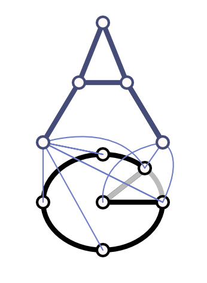

  

# abstractgraph-generative

`abstractgraph-generative` is the constructive layer of the AbstractGraph
ecosystem. It uses graph semantics from `abstractgraph` and optional learned
signals from `abstractgraph-ml` to rewrite, generate, interpolate, optimize,
and repair graphs.

## Zenodo

Version 0.1.0: [10.5281/zenodo.24367181](https://doi.org/10.5281/zenodo.24367181)  
All versions: [10.5281/zenodo.24367180](https://doi.org/10.5281/zenodo.24367180)

Documentation lives in [docs/](docs/):

- [Overview](docs/overview.md)
- [Documentation index](docs/README.md)
- [Repository organization](docs/ORGANIZATION.md)
- [Notebook guide](docs/notebooks.md)
- [Edge generator guide](docs/edge-generator.md)
- [Conditional generator guide](docs/conditional-autoregressive-generation.md)
